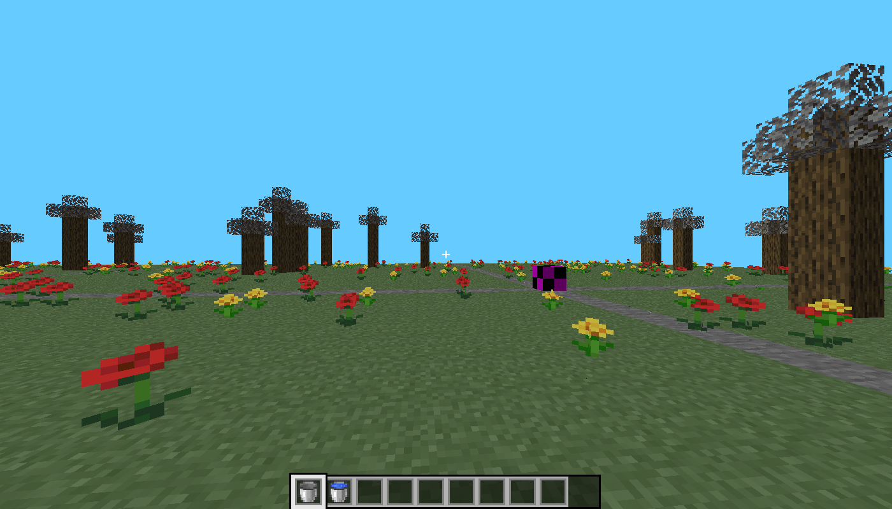
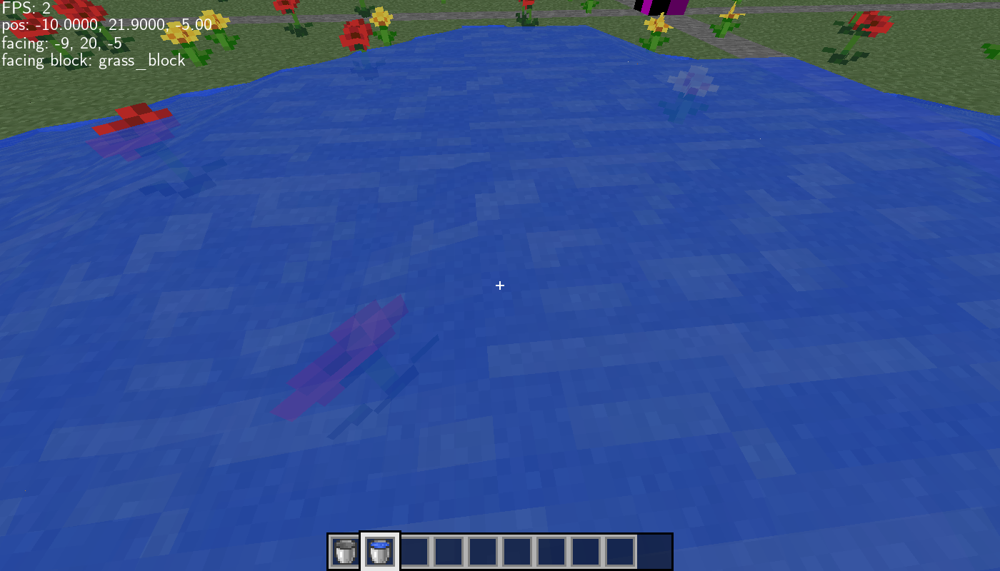
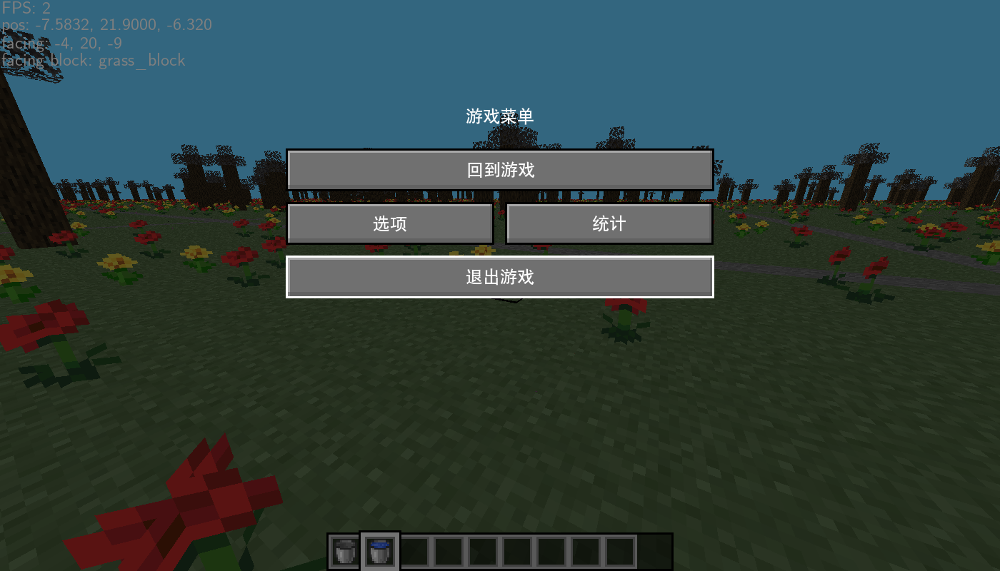

# icraft

try to imitate Minecraft in C

一个从零写起的类 Minecraft 沙盒：渲染、物理、地形、流体、UI、字体全部手写，
除 SDL2 / OpenGL / FreeType 之外没有用任何引擎。



## 它是什么

- 32³ 的 chunk 用空间哈希管理，生成丢在独立线程里，改一个方块会把六个邻居一起标脏
- 顶点按面在图集上取 uv_offset，不透明与半透明分两趟画，植物用交叉面片
- 水是挂载在方块上的 `BlockState`：1–7 级加水源，每 5 tick 做一次元胞更新，
  渲染时按邻居水位插出四角高度
- 碰撞是扫掠 AABB + time-of-impact，逐轴解算，可以贴墙滑行
- 逻辑固定 20Hz 步长，渲染时用余量做位置插值
- UI 是场景栈：HUD / 背包 / 菜单 / 调试面板各自独立，线性布局按 `zoom_level` 整体缩放
- 文字用 FreeType 逐字形生成纹理，自带一个手写的 UTF-8 解码器，所以菜单可以是中文

## 构建与运行

依赖 SDL2、OpenGL 3.3、FreeType。

```sh
make
./build/icraft.out     # 需要在仓库根目录运行，assets/ 是相对路径
```

## 操作

| 按键 | 作用 |
| --- | --- |
| W A S D | 移动 |
| 空格 | 跳 |
| 鼠标 | 转头 |
| 左键（按住） | 挖方块 |
| 右键 | 放置 / 使用物品 |
| 滚轮 | 切换快捷栏 |
| Q | 丢弃 |
| E | 背包 |
| F3 | 调试信息 |
| Esc | 菜单 |
| F11 | 全屏 |

## 截图

倒一桶水，它会自己往外铺：



中文菜单，来自 FreeType 和那个 90 行的 UTF-8 解码器：



## 状态

已归档，不再继续开发。世界每次启动都是同一颗种子重新长出来的，没有存档，
没有生存循环，工作台不能用。

那段时间真好
